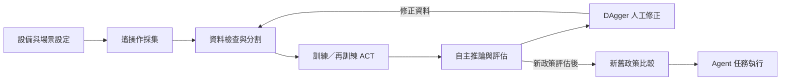

# Agentic Robotic Simulator

2026 台灣機器人挑戰賽（TRC）SO-101 單臂積木分揀專案。目標是用同一個 repo 串起模擬、實機示範、ACT 與改單流程。

從 repo 根目錄執行 `uv run tools/sim.py` 開啟模擬選單。鍵鼠操作可用 Isaac Sim 或 MuJoCo；「錄示範」會啟動 Isaac，「檢查上一筆示範」從磁碟讀回資料。環境設定見 [模擬入口](docs/sim-server.md)，抓前定位另有[兩引擎的重播指令](docs/wrist-alignment.md)。

## 競賽流程規劃

各階段設計為可獨立執行。模擬採集、讀回與定位基準已有入口，單臂積木 ACT 訓練與推論待整合。Agent 只在最上層呼叫已驗證的技能。

## 設計重點

- **共用任務核心，分開後端**：Isaac Sim 與 MuJoCo 共用場景設定；實機錄製在獨立整合分支，完整 `real` 與 `mock` 後端仍在規劃中。
- **ACT 為主線**：政策經 adapter 接入，預留 Diffusion Policy、π0.5 等替代政策。
- **操作輸入共用一個介面**：模擬端先用 keyboard／mouse 操作末端（EE），再接實體 SO-101 leader，controller 最後。
- **場地與任務分開**：已提供 `lab_current_minimal` 與 `lab_20261120`；`competition_draft` 待場地量測。
- **DAgger 規劃**：人工接管 → 修正資料保存 → 檢查 → 明確納入再訓練 → 同條件比較新舊政策。
- **依賴環境分開**：同一 repo，模擬端、訓練端、實機執行端可使用各自的 Python 環境。

## 目前狀態

| 項目 | 狀態 |
|---|---|
| 模擬操作與錄製 | 兩個引擎均可鍵鼠控制 EE、進入全螢幕工作區與錄製視窗 MP4。Isaac 另可錄製含雙相機與關節資料的示範 episode，供離線讀回。 |
| 聊天與整單執行 | `tools/lab.py` 啟動實驗室模擬與聊天。LLM 解析訂單和回答，執行器管理需求帳本。MuJoCo 決賽缺料整單（改色／等補料）的選料與缺料複查改用相機，12 次驗收與聊天主秀都通過；抓取為腳本技能，交付核對仍讀模擬真值。[決賽整單](docs/finals-shortage.md) |
| 抓前定位 B | 獨立基準。MuJoCo 主測首次 233/234、含一次重抓 234/234，相鄰紅塊 21/24。Isaac 三場開啟單次 Z 補償後均通過懸停門檻並提起近顆。[方法與重播](docs/wrist-alignment.md) |
| 實機資料與 ACT | 單臂錄製與讀回在實機整合分支。規劃以 leader 收集紅、藍、黃雙向共 120 筆；收齊後用實拍做離線定位。單臂積木 ACT 與 DAgger 再訓練待驗。 |

各階段的現況與待辦見 [docs/status.md](docs/status.md)。

## 執行環境角色

| 角色 | 用途 |
|---|---|
| 實機執行端 | 連接 SO-101 follower／leader 與相機，執行實機採集、推論與 DAgger 驗證 |
| 模擬端 | 執行 Isaac Sim 或 MuJoCo 場景、keyboard／mouse 遙操作與模擬評估；以實體 leader 操作時，leader 接在執行模擬的同一台電腦 |
| 訓練端 | 執行 ACT 等政策訓練與離線評估 |

程式可在任何開發環境撰寫；涉及硬體的行為須在實機執行端驗證。機器專屬設定、原始校正與大型資料不進 repo，repo 只放範本、格式與版本說明（見 [docs/architecture.md](docs/architecture.md#設定與資料的存放)）。

## 文件

| 文件 | 內容 |
|---|---|
| [docs/architecture.md](docs/architecture.md) | 系統分層、後端、控制權、模組與環境劃分 |
| [docs/interfaces.md](docs/interfaces.md) | 設定規格、命令契約、leader 輸入 adapter、技能結果 |
| [docs/scenes-and-tasks.md](docs/scenes-and-tasks.md) | 資產、場地配置、任務定義與量測需求 |
| [docs/teleop-data-training.md](docs/teleop-data-training.md) | 遙操作、episode 資料、檢查與分割、ACT 訓練 |
| [docs/inference-dagger-evaluation.md](docs/inference-dagger-evaluation.md) | 自主推論、DAgger 閉環、再訓練比較與評估 |
| [docs/agent.md](docs/agent.md) | Agent、任務執行器、需求帳本與缺料流程 |
| [docs/finals-shortage.md](docs/finals-shortage.md) | MuJoCo 決賽整單：中途缺料、改色或等補料，相機選料與複查、場景事件、驗收批次與聊天主秀 |
| [docs/task-executor.md](docs/task-executor.md) | 需求帳本與任務執行器的實作、改單規則、驗收場景（#5） |
| [docs/chat-layer.md](docs/chat-layer.md) | 繁中聊天層：模型服務、意圖規則、語句表與完整對話驗收（#7） |
| [docs/lab-scene-cameras.md](docs/lab-scene-cameras.md) | 實驗室單臂場景（2026-11-20 配置）、D455／腕部相機視角、相機位姿推算與實機對照 |
| [docs/lab-entry.md](docs/lab-entry.md) | 一鍵入口 `tools/lab.py`、聊天視窗、常駐相機畫面、腕部鏡頭變形、競賽流程驗收（#11） |
| [docs/perception.md](docs/perception.md) | RGB 積木實例分割、顏色估計、追蹤 ID、CLI 與微調說明 |
| [docs/random-blocks.md](docs/random-blocks.md) | 隨機積木數量、顏色與合法初始位置；啟動／Reset 抽樣與 seed 重現 |
| [docs/remote-desktop.md](docs/remote-desktop.md) | 瀏覽器桌面啟動 Isaac 與 host 隔離環境 MuJoCo |
| [docs/operator-workspace.md](docs/operator-workspace.md) | 全螢幕操作工作區（M）、相機格原圖／標註、UI FPS／RTF／感知年齡、右欄畫面錄影、效能對照（#16） |
| [docs/demo-capture.md](docs/demo-capture.md) | 模擬示範採集：錄製指令、資料格式與單位、讀回與三個時刻、人工示範驗收（#13） |
| [docs/isaac-ee-teleop.md](docs/isaac-ee-teleop.md) | Isaac Sim 最小場景與 keyboard／mouse EE 操作：環境、啟動、操作、驗收、已知問題 |
| [docs/sim-server.md](docs/sim-server.md) | 實驗設定檔、選單、主機端 uv 環境、模擬伺服器控制協定 |
| [docs/wrist-alignment.md](docs/wrist-alignment.md) | 抓前定位 B、MuJoCo 基準、Isaac 單次 Z 補償重播與 ACT 接手條件 |
| [docs/mujoco-backend.md](docs/mujoco-backend.md) | MuJoCo 安裝、模型與模擬入口 |
| [docs/status.md](docs/status.md) | 已完成／預計實作／待確認、可沿用資產與參考來源 |

### VS Code Remote：瀏覽器操作

執行 `docker/isaac/remote.sh run`，在 VS Code **Ports** 轉發 **6080**，開啟 `http://localhost:6080/vnc.html?autoconnect=1&resize=scale`。預設顯示隨機積木場景與即時八頂點預覽；詳見 [遠端桌面](docs/remote-desktop.md)。

開發與交接請見[開發規則](AGENTS.md)。
