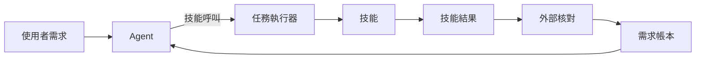

# Agent 與任務執行

Agent 是最上層：理解需求、呼叫技能、依執行結果調整剩餘任務。底層採集、訓練、推論都不依賴 agent。

## 分工

| 元件 | 做什麼 |
|---|---|
| Agent | 解析需求；決定下一個技能、重看、詢問使用者或暫停 |
| 任務執行器 | 執行技能序列、管理控制權、取消與重試（每步上限依 `TaskSpec`） |
| 需求帳本 | 記錄每項需求的目標數量、已完成數量、狀態；只在外部核對後增加完成數 |
| 工具紀錄 | 每次技能呼叫、參數、結果與耗時，用於任務評估 |

任務執行器與需求帳本已在模擬中實作（#5，只用模擬真值、腳本化抓取，不含 LLM），改單、持物、多交、缺料的規則見 [task-executor.md](task-executor.md)。繁中聊天入口見 [chat-layer.md](chat-layer.md)。

Agent 不逐週期控制馬達，也不自行宣告物品已送達。

## 技能

預計的單顆抓放序列：

1. 全局定位（Global 相機辨色與定位）
2. 幾何接近
3. ACT 對準、下降、夾取、抬起
4. 幾何搬運放置
5. 外部核對

首要驗證的是第 2→3 步的接手條件（接近後的姿態是否落在 ACT 示範分布內）。

## 缺料流程

決賽訂單是兩紅一藍，藍色先放。開場粉色儲存盤有紅 2、藍 1、黃 1，米色備料盤為空。

1. 先放一藍，再放一紅。確認米盤已交付一藍一紅、手臂停在待命點後，操作者取走粉盤最後一顆紅塊。米盤裡的兩顆留在原位。
2. 預計用全域相機重看、腕部相機複查。仍看不清時繼續觀測。確認只缺一紅、粉盤還有黃色時，可問：「已放好一藍一紅，還缺一紅。剩下這顆要改黃，還是等你補紅？」
3. **改黃**：只改尚未交付的一顆，補上一黃，以紅 1、藍 1、黃 1 結單。**等補紅**：保留原訂單，人把一顆紅塊補回粉盤；重新確認有紅塊後只取這一顆，以紅 2、藍 1 結單。

現行模擬執行器提供換色、等補料及減量三種選項，以模擬真值讀取盤面。抓取順序依帳本中的顏色順序；展示要先出藍，需讓藍色排第一。上述相機複查、人工取料時的停臂，以及實機整單流程仍待整合驗收。[既有腳本與驗收情境](task-executor.md)

## 介面

- 輸入：聊天框或情境選擇（預設任務）。
- 技能呼叫與結果格式見 [interfaces.md](interfaces.md#技能結果)。
- 開發使用 Qwen3.5-9B。實機開發可先驗 Q4_K_M，Thor 優先測 BF16，最終選擇依實測資源與延遲決定。
