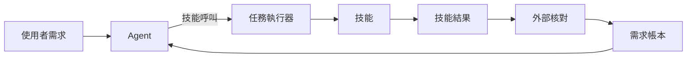

# Agent 與任務執行

Agent 是最上層：理解需求、呼叫技能、依執行結果調整剩餘任務。底層採集、訓練、推論都不依賴 agent。

## 分工

| 元件 | 做什麼 |
|---|---|
| Agent | 解析需求；決定下一個技能、重看、詢問使用者或暫停 |
| 任務執行器 | 執行技能序列、管理控制權、取消與重試（每步上限依 `TaskSpec`） |
| 需求帳本 | 記錄每項需求的目標數量、已完成數量、狀態；只在外部核對後增加完成數 |
| 工具紀錄 | 每次技能呼叫、參數、結果與耗時，用於任務評估 |

Agent 不逐週期控制馬達，也不自行宣告物品已送達。

## 技能

預計的單顆抓放序列：

1. 全局定位（Global 相機辨色與定位）
2. 幾何接近
3. ACT 對準、下降、夾取、抬起
4. 幾何搬運放置
5. 外部核對

首要驗證的是第 2→3 步的接手條件（接近後的姿態是否落在 ACT 示範分布內）。

## 缺料流程

示範情境：需求紅 2、藍 1。

1. 送出紅 1 後，待命期間剩餘紅料被移除。
2. 重新觀察，發現紅料不足。
3. 依指令：若允許先做其他，就先送藍並詢問使用者；若要求缺料停止，就暫停。
4. 使用者改為黃 1 後，只補未完成項目，不重送已完成的紅 1。
5. 替代顏色由使用者決定，agent 不擅自替換。

## 介面

- 輸入：聊天框或情境選擇（預設任務）。
- 技能呼叫與結果格式見 [interfaces.md](interfaces.md#技能結果)。
- 模型服務（使用哪個 LLM、本機或雲端）待確認。
