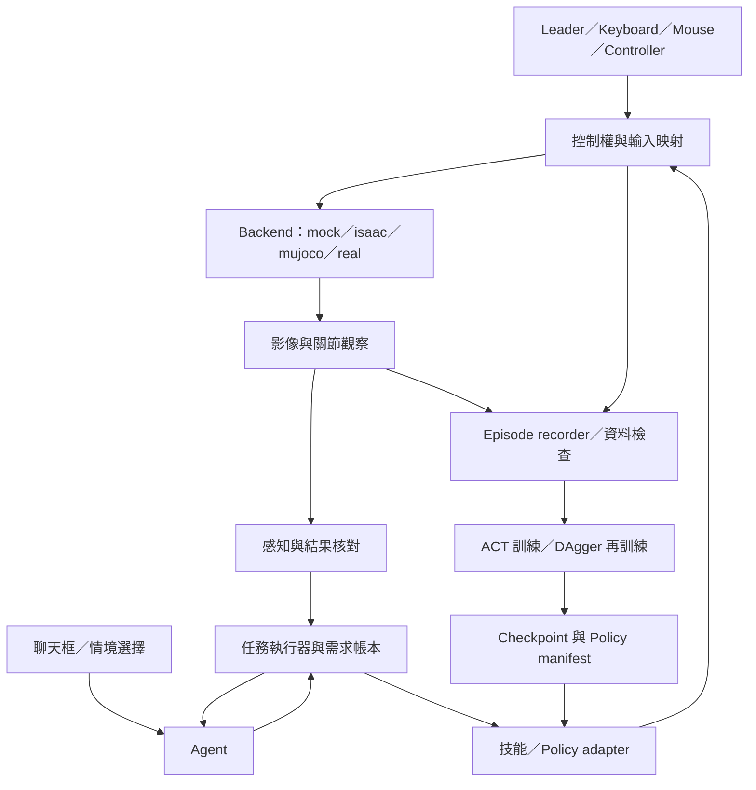

# 系統架構

## 分層

| 層 | 責任 | 不負責 |
|---|---|---|
| Agent | 理解需求、選技能、依結果調整剩餘任務、決定重看／詢問／暫停 | 逐週期控制馬達；自行判定物品已送達 |
| 任務執行器 | 技能順序、控制權、取消、重試、結果回報；維護需求帳本 | 解讀自然語言 |
| 技能／Policy adapter | 幾何技能（接近、搬運、放置）與學習政策（ACT 等）；封裝影像、狀態、正規化與動作段 | 決定任務順序 |
| 控制權與輸入映射 | 決定當下由人或政策控制；把各種輸入轉成統一命令 | 任務邏輯 |
| Backend | 把命令送到 mock／Isaac Sim／MuJoCo／實機，回傳觀察 | 決策 |
| 感知與結果核對 | RGB 辨色；深度與外參做位置轉換；核對動作結果，信心不足回報不確定 | 修改任務 |
| 資料與訓練 | 記錄 episode、檢查、分割、訓練、產生 policy manifest | 線上控制 |

幾何控制與政策控制使用同一個底層命令契約（見 [interfaces.md](interfaces.md#命令契約)）。換後端時，上層不需改動。換政策時，只有在新政策的技能範圍與接手條件和原政策一致時，上層才不需改動。如果範圍或條件不同（例如以完整抓取政策取代局部 ACT），任務執行器的技能序列也要調整。

## 後端

| 後端 | 用途 | Reset |
|---|---|---|
| `mock` | 無物理，驗證任務流程、agent、資料格式 | 立即重置 |
| `isaac` | Isaac Sim 場景，遙操作採集、政策推論與評估 | 程式重置場景與隨機種子 |
| `mujoco` | MuJoCo 場景（同一份場景設定），在不能跑 Isaac 的電腦上做物理與流程驗證（[mujoco-backend.md](mujoco-backend.md)） | 程式重置場景與隨機種子 |
| `real` | SO-101 實機 | 現場復位流程，不假裝提供與模擬相同的重置 |

模擬真值只用於評分與除錯；正式 agent 執行使用感知結果，評估報表分開標示兩者。

## 模組（建議，尚未建立）

| 模組 | 內容 |
|---|---|
| `core` | 共用資料型別、設定載入、命令契約、控制權 |
| `backends` | `mock`、`isaac`、`mujoco`、`real` |
| `teleop` | keyboard／mouse EE、leader 本機輸入 adapter、controller |
| `perception` | 辨色、位置轉換、結果核對 |
| `policies` | ACT adapter 與其他政策 adapter |
| `data` | episode recorder、檢查、分割、manifest |
| `training` | 訓練入口與設定 |
| `evaluation` | rollout 評估與報表 |
| `agent` | agent、任務執行器、需求帳本 |

目錄與套件名稱在第一份 issue 確認後才建立。

## 依賴環境

同一 repo 管理共用程式、設定範本與文件，但三種角色可使用不同 Python 環境，避免 Isaac Sim、訓練框架與實機驅動互相牽制版本：

| 環境 | 主要依賴 | 備註 |
|---|---|---|
| 模擬端 | Isaac Sim／Isaac Lab、SO-101 資產 | 版本與 NVIDIA SO-101 Workshop 配套核對後記錄 |
| 訓練端 | LeRobot、PyTorch | 與資料格式版本一致 |
| 實機執行端 | LeRobot（Feetech 驅動）、相機驅動 | 沿用既有可運作環境，不為整合而升級 |

`core` 應能在三個環境中載入；只有 backend 與特定 adapter 依賴各自環境。具體版本見 [status.md](status.md#待確認)。

## 設定與資料的存放

| 類型 | 位置 |
|---|---|
| 共用程式、設定範本、schema、文件 | 本 repo |
| 機器專屬設定（序列埠、相機裝置、校正 ID） | 各執行端本機，自範本複製，不進版控 |
| 原始馬達校正、相機內外參原始檔 | 對應設備端或量測來源；repo 只記錄格式與版本引用 |
| Episodes、checkpoint 等大型資料 | 資料儲存位置；repo 只放 manifest 格式與版本規則 |

設定以版本或 ID 引用校正與資料，讓 episode 與 checkpoint 能追溯到當時的場地、校正與政策版本。
