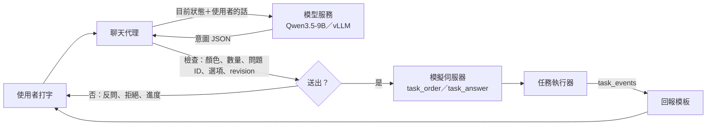

# 繁中聊天層

對應 issue [#7](https://github.com/jxuan083/agentic-robotic-simulator/issues/7)。在任務執行器（[task-executor.md](task-executor.md)）之上加一個繁體中文的命令列聊天：模擬執行時，使用者直接打字下單、改單、回答執行器的問題、查詢進度。

- 聊天層只送 `task_order`、`task_answer` 兩種任務命令，以及讀取 `task_state`、`task_events`。手臂控制、取消動作、交付核對都仍由執行器負責。
- 模型只負責判斷意圖，輸出受 JSON schema 限制的結構化結果；程式依當下的帳本與問題檢查後才送出。回覆與回報使用固定的繁中模板。
- 開發候選模型是 Qwen3.5-9B（Apache-2.0），在本機用 vLLM 的 OpenAI 相容 API 提供服務。模型服務可替換（`configs/chat.yaml`）。

## 架構



## 啟動

```bash
docker/vllm/serve.sh up                     # 模型服務（第一次會下載約 20 GB 權重到 ~/docker/vllm/hf-cache）
tools/mujoco_server.sh up                   # 或 docker/isaac/server.sh up
uv run tools/chat.py --backend mujoco --load --block-colors red,red,red,blue,blue,yellow
```

```text
> 我要三顆紅色的積木
好的，需求改為 紅色 3。
[系統] 需求已生效（第 1 版）：紅色 3。
> 總共一紅兩藍就好
好的，需求改為 紅色 1、藍色 2。
[系統] 需求已生效（第 2 版）：紅色 1、藍色 2。
[系統] 手上的紅色積木，新的需求用不到。要放回原位、放到其他位置，還是照樣送出？（問題 1）
> 放回去
好的，放回原位。
> 現在做到哪？
需求（第 2 版）：紅色 1、藍色 2；已核對交付：紅色 1；還要：藍色 2；手上：沒有。狀態：進行中。
```

- `--load` 會重新載入場景（沒有任務）；`--block-colors` 指定每顆積木的顏色。
- 輸入 `exit` 離開。離開聊天不會停止模擬或任務。
- 要立刻停下手臂請用模擬器的 Pause（P 鍵或面板按鈕）；要結束任務請執行 `uv run tools/task.py --backend <引擎> stop`。聊天層不負責停止。

| 項目 | 實測版本 |
|---|---|
| 模型 | `Qwen/Qwen3.5-9B`（BF16，只用語言模型部分），思考模式關閉 |
| 模型服務 | `vllm/vllm-openai:v0.17.1`（Qwen3.5 需要 vLLM 0.17.0 以上），只監聽 127.0.0.1:8000 |
| GPU 記憶體 | `--gpu-memory-utilization 0.72`（`LLM_GPU_UTIL`），保留給同一張卡上的模擬器 |
| 輸出 | `response_format` JSON schema（顏色只能是色票代號，數量 0–8） |

## 意圖與規則

| 使用者的話（例） | 意圖 | 送出 |
|---|---|---|
| 「我要三顆紅色」「總共一紅兩藍」「只要兩顆黃色」 | `order_total`：完整的新需求 | `task_order` `total` |
| 「再加一顆藍色」「另外再多兩個黃的」 | `order_add`：追加 | `task_order` `add` |
| 「藍色改成三顆」「紅的不要了」 | `order_set`：只改這些顏色，其他保留 | `task_order` `total`（由目前需求算出） |
| 「改成兩藍」，而目前需求還有其他顏色 | `clarify`：先問其他顏色要不要保留 | 不送；收到回答後才送 |
| 「放回去」「照樣送出」「換成黃色」「等補料」 | `answer`：綁定目前問題的 ID 與選項 | `task_answer` |
| 「現在做到哪？」「還差幾顆？」 | `status`：只讀帳本回答 | 不送 |
| 「我要綠色的」（淺綠或深綠？）、「再來幾顆藍色」 | `clarify` | 不送 |
| 「手臂往左移五公分」「我要十顆紅色」「粉紅色」 | `reject` | 不送 |
| 「停！」「緊急停止」 | `stop`：指引使用獨立的停止入口 | 不送 |

程式檢查（模型的輸出不會未經檢查就送出）：

- 顏色只能是色票代號，數量 0–8；需求的顏色不在場景中時照送，但會提醒「系統會回報缺料」。
- 回答必須對應目前有效的問題 ID，選項必須在該問題的選項內；換色要指定場景中有的顏色；放到指定位置要有座標。
- **送出前再讀一次狀態**：模型思考期間帳本 revision 或問題改變了，就用新狀態重新判斷一次；再變就請使用者重說。
- **重送只生效一次**：每一句話送出的命令帶一個 `request_id`。傳輸失敗時用同一個 id 重送，伺服器只執行一次並回傳 `"duplicate": true`。使用者刻意再說一次相同的追加，是新的一句、新的 id，會再追加一次。
- 模型服務沒有回應或回覆不是 JSON 時，這句話不送出，並告訴使用者。

主動回報（`[系統]`）：需求生效、需要選擇（持物、缺料）、問題取消、多交、完成、異常（回答未被接受、結果無法核對、掉落、夾取失敗、動作失敗）。一般的移動過程只在模擬器面板顯示。

## 驗收

| 驗收 | 方式 | 工具 |
|---|---|---|
| 語句表（真模型） | 固定的繁中語句表：總數／追加、只改單一顏色、顏色同義詞、「兩」與「2」、歧義、無效要求、停止、進度、回答問題。分開記錄正確命令、正確反問、正確不送、漏送、誤執行 | `uv run tools/chat_eval.py`（`configs/chat/utterances.yaml`） |
| 重播（固定回覆） | 持物放回、缺料換色、傳輸重送、刻意重複追加、思考期間狀態改變、模型服務中斷；核對 revision、問題 ID、最終交付 | `tests/test_chat.py` |
| 完整對話（真模型＋GUI） | 原訂三紅 → 搬運第二顆紅塊時說「總共一紅兩藍就好」→ 回答「放回去」→ 帳本確認一紅兩藍；保存逐句輸入、實際命令、執行器事件、最終帳本與版本 | `uv run tools/chat.py --backend <引擎> --script configs/chat/dialogues/hold_return.yaml` |

### 結果（2026-11-19，Qwen3.5-9B、vLLM 0.17.1、temperature 0）

**語句表**：49 句，跑 3 次，每次判定都相同。

| 組別 | 句數 | 結果 |
|---|---|---|
| 完整需求（總數） | 7 | 正確命令 7 |
| 追加 | 4 | 正確命令 4 |
| 只改單一顏色 | 4 | 正確命令 4 |
| 顏色同義詞、數字寫法 | 6 | 正確命令 6 |
| 歧義 | 7 | 正確反問 6；「來一顆水藍色」回覆「不支援水藍色，請用藍色或青色」，沒有送出，但不是反問 |
| 無效要求 | 5 | 都沒有送出 |
| 停止 | 2 | 都指引到停止入口 |
| 詢問進度 | 3 | 都只讀帳本回答 |
| 回答問題 | 11 | 正確命令 9；沒有待答問題、換成場景中沒有的顏色，各 1 句，都沒有送出 |
| **合計** | **49** | **正確 48，誤執行 0，漏送 0**；延遲中位數 1.0 秒、最大 1.3 秒 |

第一次跑的結果是 48 句中 40 句正確，誤執行 3、漏送 5。依據失敗原因做了以下修改（同一份語句表調整後再測，所以上面的數字可能偏樂觀；新句子要另外補）：

- **啟動暖機**：第一個請求要編譯 schema 的文法，前 3 句因此逾時。現在啟動時先送一個請求（約 1 秒）。
- **數量上限改由程式檢查**：schema 原本限制數量最多 8，模型無法寫出「十顆」，結果送出了 1 顆。現在 schema 放寬到 99，超過 8 由程式拒絕。
- **提示詞**：
  - 「幫我放一顆紅色到放置盤」是下單，不是直接控制手臂。
  - 「幾顆」「一些」沒有數字時要反問，數量不要自己改小。
- **程式層的歧義檢查**：模型在兩種情況會猜：「再來幾顆藍色」直接送了 2 顆；原單有紅、藍時說「改成三黃」，直接送了紅 1、藍 2、黃 3。這兩種說法改由程式判斷並反問，不依賴模型：
  - 數量含糊。
  - 「改成＋數量」，且使用者沒提到原單中的其他顏色，也沒說「總共／只要／保留」。
- **語句表本身的錯誤**：
  - 「水藍」可能指淺藍，從青色的同義詞中拿掉，改列為歧義句。
  - 「放到 0.30, 0.05 的位置」在 YAML 中被逗號截斷，已修正。

**完整對話**（`hold_return`）：每個引擎跑 3 次，全部 5/5 通過。

| | Isaac | MuJoCo |
|---|---|---|
| 送出的命令（每次都相同） | `task_order {red: 3}`、`task_order {red: 1, blue: 2}`、`task_answer {id: 1, return}` | 同左 |
| 「總共一紅兩藍就好」生效的時間（模擬時間） | 13.0–13.5 秒（第二顆紅塊搬運中） | 12.4–13.8 秒 |
| 執行器提問 | 生效後約 0.13 秒提出問題 1 | 約 0.03 秒 |
| 最終帳本 | 紅 1、藍 2，已完成 | 同左 |
| 每句的模型延遲 | 0.8–1.4 秒 | 0.8–1.3 秒 |
| 思考期間狀態改變而重新判斷 | 0 次 | 0 次 |
| 整段對話（牆鐘時間） | 約 55 秒 | 約 34 秒 |

- 模型服務與 Isaac 同時執行時，GPU 記憶體用到 30.5／32.6 GB。
- 回歸測試：#5 的 6 個任務場景在兩個引擎重跑都通過；純邏輯測試全部通過。

## 已知問題與限制

- 只有命令列，沒有語音與聊天視窗。
- 模型的判斷不是 100% 正確；誤判時程式的檢查能擋下不合法的命令，但擋不下「合法但不是使用者要的」命令。語句表的### 結果（2026-11-19，Qwen3.5-9B、vLLM 0.17.1、temperature 0）

**語句表**：49 句，跑 3 次，每次判定都相同。

| 組別 | 句數 | 結果 |
|---|---|---|
| 完整需求（總數） | 7 | 正確命令 7 |
| 追加 | 4 | 正確命令 4 |
| 只改單一顏色 | 4 | 正確命令 4 |
| 顏色同義詞、數字寫法 | 6 | 正確命令 6 |
| 歧義 | 7 | 正確反問 6；「來一顆水藍色」回覆「不支援水藍色，請用藍色或青色」，沒有送出，但不是反問 |
| 無效要求 | 5 | 都沒有送出 |
| 停止 | 2 | 都指引到停止入口 |
| 詢問進度 | 3 | 都只讀帳本回答 |
| 回答問題 | 11 | 正確命令 9；沒有待答問題、換成場景中沒有的顏色，各 1 句，都沒有送出 |
| **合計** | **49** | **正確 48，誤執行 0，漏送 0**；延遲中位數 1.0 秒、最大 1.3 秒 |

第一次跑的結果是 48 句中 40 句正確，誤執行 3、漏送 5。依據失敗原因做了以下修改（同一份語句表調整後再測，所以上面的數字可能偏樂觀；新句子要另外補）：

- **啟動暖機**：第一個請求要編譯 schema 的文法，前 3 句因此逾時。現在啟動時先送一個請求（約 1 秒）。
- **數量上限改由程式檢查**：schema 原本限制數量最多 8，模型無法寫出「十顆」，結果送出了 1 顆。現在 schema 放寬到 99，超過 8 由程式拒絕。
- **提示詞**：
  - 「幫我放一顆紅色到放置盤」是下單，不是直接控制手臂。
  - 「幾顆」「一些」沒有數字時要反問，數量不要自己改小。
- **程式層的歧義檢查**：模型在兩種情況會猜：「再來幾顆藍色」直接送了 2 顆；原單有紅、藍時說「改成三黃」，直接送了紅 1、藍 2、黃 3。這兩種說法改由程式判斷並反問，不依賴模型：
  - 數量含糊。
  - 「改成＋數量」，且使用者沒提到原單中的其他顏色，也沒說「總共／只要／保留」。
- **語句表本身的錯誤**：
  - 「水藍」可能指淺藍，從青色的同義詞中拿掉，改列為歧義句。
  - 「放到 0.30, 0.05 的位置」在 YAML 中被逗號截斷，已修正。

**完整對話**（`hold_return`）：每個引擎跑 3 次，全部 5/5 通過。

| | Isaac | MuJoCo |
|---|---|---|
| 送出的命令（每次都相同） | `task_order {red: 3}`、`task_order {red: 1, blue: 2}`、`task_answer {id: 1, return}` | 同左 |
| 「總共一紅兩藍就好」生效的時間（模擬時間） | 13.0–13.5 秒（第二顆紅塊搬運中） | 12.4–13.8 秒 |
| 執行器提問 | 生效後約 0.13 秒提出問題 1 | 約 0.03 秒 |
| 最終帳本 | 紅 1、藍 2，已完成 | 同左 |
| 每句的模型延遲 | 0.8–1.4 秒 | 0.8–1.3 秒 |
| 思考期間狀態改變而重新判斷 | 0 次 | 0 次 |
| 整段對話（牆鐘時間） | 約 55 秒 | 約 34 秒 |

- 模型服務與 Isaac 同時執行時，GPU 記憶體用到 30.5／32.6 GB。
- 回歸測試：#5 的 6 個任務場景在兩個引擎重跑都通過；純邏輯測試全部通過。
- 回報只用模板，模型不會改寫；英文語句沒有測。
- 模型與模擬器共用一張 GPU；Isaac 與模型同時跑時要留意記憶體（`LLM_GPU_UTIL`）。

## 檔案

| 路徑 | 內容 |
|---|---|
| `src/agentic_sim/chat/llm.py` | OpenAI 相容的模型服務客戶端、重播客戶端 |
| `src/agentic_sim/chat/intent.py` | 意圖 schema、提示詞、對照目前狀態的檢查 |
| `src/agentic_sim/chat/agent.py` | 一句話的流程（讀狀態、問模型、檢查、重讀、送出）、回報 |
| `src/agentic_sim/chat/zh.py` | 繁中模板：顏色、數量、問題、事件回報、進度 |
| `configs/chat.yaml` | 模型服務設定、顏色的中文名稱與同義詞 |
| `configs/chat/utterances.yaml` | 語句表 |
| `configs/chat/dialogues/hold_return.yaml` | 完整對話驗收腳本 |
| `docker/vllm/serve.sh` | 模型服務 |
| `tools/chat.py` | 聊天 CLI、腳本對話 |
| `tools/chat_eval.py` | 語句表評估 |
| `tests/test_chat.py` | 意圖檢查、模板、重播流程 |
