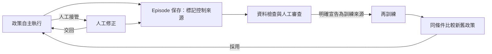

# 推論、DAgger 與評估

## 自主推論

推論可獨立執行，不需要 agent：載入 checkpoint 與 policy manifest → 依 manifest 前處理觀察 → 取得動作段 → 經命令契約送往 backend → 回報技能結果與 rollout 紀錄。

- 政策可在本機執行，或由推論服務提供、執行端透過網路取得動作段（既有實機程式採 WebSocket 推論服務與執行端分離）。
- 動作段佇列在接管、任務變更、斷線時清空。
- 每次 rollout 記錄耗時、結果與失敗分類，供評估與 DAgger 使用。

## DAgger 閉環

### 既有可沿用的實機行為

| 項目 | 既有實作 |
|---|---|
| 控制權切換 | 鍵盤切換自主／人工；交出前 follower 保持、leader 釋放力矩並倒數，讓操作者握好 leader |
| 無跳動接管 | 人工目標相對於接管後擷取的 leader／follower 原點 |
| 交回 | leader 對齊 follower 姿態、保持後清除政策狀態 |
| 舊動作 | 雙向切換都清空動作佇列；交回時重置推論 session |
| 來源標記 | 每幀標記人工或政策 |
| 保存 | 可保存、丟棄當前 episode；背景寫入 |
| 加權載入 | 訓練載入器可提高人工幀權重、降低接管前數秒的自主幀權重；只對明確宣告為 DAgger 的資料來源生效 |

既有實作為雙臂配置，移植時改為單臂並接到本 repo 的命令契約與 episode 格式。

### 待補齊的串接

1. 修正 episode 進入資料檢查（數量、影像、來源分布），並人工審查修正內容。
2. 審查後在訓練設定中明確加入該資料來源。正規化統計重算或沿用，依訓練配方決定：先檢查新資料與現行前處理是否相容，並把選擇記錄在 manifest。
3. 再訓練產生新 checkpoint 與 manifest，記錄所含修正資料版本與使用的正規化統計；推論時以 manifest 確認 checkpoint 與前處理一致。
4. 以相同評估配置比較新舊政策，決定是否採用。

「完成修正採集」與「完成再訓練評估」分開標示：收集到修正資料不等於模型已改善，只有完成第 2–4 步並有比較結果，才記為一輪 DAgger 完成。硬體通訊或過載錯誤中止的 episode 不當成乾淨修正。

### 模擬端 DAgger

模擬端同樣支援接管，輸入可為 keyboard／mouse 或 leader。模擬修正資料與實機 DAgger 資料使用不同命名空間，納入訓練前需另行宣告。

## 評估

### 評估配置

固定一組評估配置（場地、任務、積木位置種子、相機設定）作為比較基準。新舊政策、sim 與 real 都在已記錄的配置上比較。

### 紀錄與失敗分類

選錯色、抓空、掉落、結果不確定、不可達、逾時、被接管，以及各段耗時。依分類判斷該改感知、政策還是任務決策。報表分開標示模擬真值與感知結果。

### 驗收目標

以下沿用原企劃的初步目標，尚未達成：

| 項目 | 目標 |
|---|---|
| 抓取 | 20 次至少 16 次成功 |
| 需求完成 | 10 筆 2–3 顆的需求，至少 8 筆於 120 秒內完成 |
| 缺料 | 3 次缺料流程不重送、不擅自替換；每步最多重試 2 次 |

流程驗收涵蓋：採集可保存與重播、訓練可追溯、推論可獨立執行、DAgger 可接管並納入再訓練、agent 能依結果調整任務。
