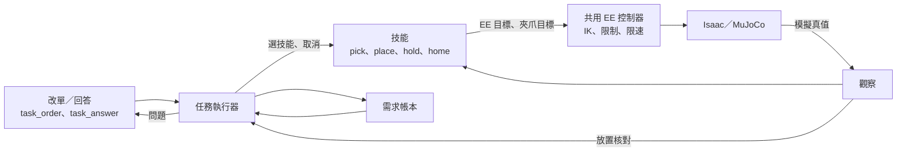

# 需求帳本與任務執行器

對應 issue [#5](https://github.com/jxuan083/agentic-robotic-simulator/issues/5)。在模擬中做到「需求可以中途修改，系統知道已完成多少，並依實際結果修正剩下的工作」。之後的 agent、感知與 ACT 都接在這一層上。

- 只用模擬真值判斷積木位置與交付結果，證據標明 `sim_truth`；之後由相機感知取代。
- 改單用結構化命令輸入（伺服器指令或 CLI），這裡不接 LLM、聊天介面或自然語言解析。
- 抓取段先用腳本化技能，只靠物理接觸；介面保留給之後的 ACT。
- 速度、高度、放置格位等參數都是 `provisional`（`configs/task.yaml`），只在暫定場景中調過。

## 架構



| 元件 | 做什麼 | 檔案 |
|---|---|---|
| 需求帳本 | 每個顏色的需求數量、已交付（核對過）、使用者同意的多交、無法核對的結果；每次改單是新的 revision；所有變化寫成事件，可重播 | `src/agentic_sim/task/ledger.py` |
| 技能 | 分階段的狀態機，每幀只對共用控制器提出 EE 目標與夾爪目標；每一幀都可接收取消，依階段處理 | `src/agentic_sim/task/skills.py` |
| 任務執行器 | 依帳本選下一個技能；改單時重新檢查目前技能；提出問題、處理回答；核對交付 | `src/agentic_sim/task/executor.py` |
| 場景腳本 | 依技能階段、交付或問題觸發改單與回答，結束時檢查結果；兩個引擎共用 | `src/agentic_sim/task/scenario.py`、`configs/tasks/*.yaml` |

任務執行時，執行器是唯一的控制來源：鍵盤、滑鼠與面板的移動輸入都會被丟棄。暫停（P、面板、伺服器）仍有效；Reset 會結束任務，手臂交回操作者。

## 行為

| 情況 | 行為 |
|---|---|
| 改單的語意 | `total` 是新的總需求（沒列到的顏色不再需要）；`add` 是在原需求上增加；`set` 只改列出的顏色（0 表示不要了），其他顏色保留，在執行器套用時才和當時的需求合併，所以先到的其他改單不會被蓋掉 |
| 數量上限 | 套用後每個顏色最多 `order.max_per_color`（8，`configs/task.yaml`）。下單時連同還沒套用的改單一起檢查，超過就拒絕（帳本與 revision 不變）；套用時再檢查一次，超過就發 `order_rejected` 事件 |
| 改單時還沒夾到東西 | 這個顏色還需要就繼續；不需要就依階段停止：接近或下降中垂直退回安全高度；夾爪正在閉合就先張開再退回 |
| 改單時手上夾著東西，新需求還要這個顏色 | 照常送完 |
| 改單時手上夾著東西，新需求不要這個顏色 | 停下並保持夾持（低於安全高度就先垂直抬起），提出問題：放回原位（`return`）、放到指定位置（`place_at`，帶 `xy`）、照樣送出（`deliver`）。回答前不鬆爪、不回 home |
| 照樣送出 | 放進放置盤，回報「多交、使用者同意」，不取回 |
| 已經鬆爪、數量超過新需求 | 回報多交，從放置盤把最後放的那顆取回來源盤（原位置，原位置被佔就放最近的空位） |
| 缺料 | 先做能做的；做完仍缺時提出問題，內容包含已交付、缺少數量、來源盤剩下的顏色。選項：換色（`substitute`，帶 `color`）、減量（`reduce`）、等補料（`wait`）。不自行換色 |
| 回答之後又改單 | 新需求又需要手上的顏色時，問題作廢，直接送出 |

### 技能與取消

| 技能 | 階段 | 改單取消時 |
|---|---|---|
| `pick` | `rise`、`approach`、`descend` | 垂直退回安全高度，手上沒有東西 |
| | `close` | 張開夾爪再垂直退回 |
| | `lift` | 停在原處，手上有積木，交給執行器處理 |
| `place` | `rise`、`transport` | 停在原處，手上有積木 |
| | `lower` | 垂直退回安全高度，手上有積木 |
| | `release`、`retreat`、`verify` | 不可取消（已鬆爪），做完後依結果處理多交 |
| `hold` | `rise`、`hold` | 等回答；回答後結束 |
| `home` | `rise`、`home` | 有新工作就停 |

- 取消後的退回動作本身不可再取消。
- 「已停止」以手臂實際停下為準：關節命令已到 IK 解，而且量測到的關節速度（相鄰幀位置差）低於門檻。不以送出停止要求為準。
- 每一幀的命令都帶著它所屬的 revision。改單後，繼續執行的技能改標新 revision，取消後的退回動作也屬於新 revision；舊 revision 的命令不再出現。

### 交付核對

放置後退到安全高度，等最多 1.5 秒，同時符合以下條件才算交付，帳本才加一：

- 積木在目標盤內；
- 積木已靜止（速度 < 0.01 m/s）；
- 夾爪張開，EE 在積木上方至少 3 cm。

時間內沒有全部符合就記為 `uncertain`。取回的積木核對它在來源盤內後，帳本減一。

## 使用

### 經由常駐伺服器（手動下單）

```bash
tools/mujoco_server.sh up                                    # 或 docker/isaac/server.sh up
uv run tools/sim.py --backend mujoco --experiment minimal_pick_place --mode teleop \
    --block-colors red,red,red,blue,blue,yellow               # 每顆積木的顏色（決定積木數量）
uv run tools/task.py --backend mujoco order red=3            # 下單：執行器接手手臂
uv run tools/task.py --backend mujoco order red=1 blue=2     # 改單：新的總需求
uv run tools/task.py --backend mujoco order --add blue=1     # 在原需求上增加
uv run tools/task.py --backend mujoco state --watch          # 帳本、手上、技能／階段、問題
uv run tools/task.py --backend mujoco answer 1 return        # 回答問題 1
uv run tools/task.py --backend mujoco answer 2 substitute --color yellow
uv run tools/task.py --backend mujoco stop                   # 手臂交回鍵盤／滑鼠
```

面板會多出 TASK 區塊，顯示帳本、手上物件、目前技能與階段，以及待回答的問題。

### 單次執行場景（驗收）

```bash
tools/run_task.sh mujoco hold_return 1            # GUI，錄影只錄模擬器視窗
tools/run_task.sh isaac  hold_return 1 --no-video
uv run scripts/mujoco_ee_teleop.py --task configs/tasks/hold_return.yaml --task_log out.jsonl --result out.json \
    --exit_after_script                           # 直接執行
```

輸出在 `outputs/task/<場景>/<引擎>_<次>.{json,jsonl,csv,log,mp4}`：`json` 是檢查結果，`jsonl` 是執行器事件（含帳本快照，`Ledger.replay` 可重建），`csv` 是逐幀紀錄。

### 場景檔

```yaml
name: hold_return
blocks: [red, red, red, blue, blue, yellow]      # 每顆積木的顏色，依序放在場景的積木格位
order: {red: 3}
events:
  - when: {event: phase, skill: place, color: red, nth: 2, phase: transport}   # 依技能階段觸發
    after_s: 0.5                                                                # 模擬時間
    order: {total: {red: 1, blue: 2}}
  - when: {event: question, kind: held_item}
    after_s: 3.0
    answer: {choice: return}
checks: [...]
```

觸發條件是執行器事件（技能階段、核對過的交付、問題），所以每次執行、兩個引擎都在相同的階段觸發。

## 驗收

場景：來源盤放紅 3、藍 2、黃 1（缺料場景只放藍 1），初始需求紅 3。兩個引擎都在 GUI 中執行，每個場景 3 次。

| 驗收 | 場景 | 主要檢查 |
|---|---|---|
| 1. 兩次抓取之間改單 | `change_between_picks` | 紅 2、紅 3 位移 < 2 mm；最後放置盤紅 1、藍 2，帳本相符 |
| 2. 下降時改單 | `change_during_descend` | 紅 2 沒被抬起、位移 < 5 mm；之後完成藍 2 |
| 3. 搬運中改單 | `hold_return`、`hold_deliver` | 停下並詢問；等待時 EE 與積木移動 < 3 mm；回答「放回」與「照樣送出」的結果與帳本都正確；照樣送出回報多交 |
| 4. 多交取回 | `retrieve_over_delivery` | 回報多交，取回時旁邊積木位移 < 5 mm；最後紅 1、藍 2 |
| 5. 缺料 | `shortage_substitute` | 問題內容正確；回答前黃色不被碰；換黃後帳本紅 1、藍 1、黃 1 |
| 6. 舊命令失效 | 全部 | 改單後沒有任何舊 revision 的命令 |
| 7. 停止延遲 | 有取消的場景 | 只記錄，不設目標值 |

### 結果（2026-11-18）

兩個引擎都在看得到的 GUI 視窗中執行，每個場景 3 次，共 36 次，全部通過。同一引擎的 3 次結果完全相同（兩個引擎在 CPU 上都是確定性的）。

| 場景 | Isaac | MuJoCo | 完成時間（模擬秒，Isaac／MuJoCo） |
|---|---|---|---|
| `change_between_picks` | 3/3（7 項） | 3/3 | 26.1／25.5 |
| `change_during_descend` | 3/3（9 項） | 3/3 | 27.2／26.5 |
| `hold_return` | 3/3（10 項） | 3/3 | 34.9／33.9 |
| `hold_deliver` | 3/3（10 項） | 3/3 | 38.3／37.4 |
| `retrieve_over_delivery` | 3/3（8 項） | 3/3 | 38.3／37.4 |
| `shortage_substitute` | 3/3（8 項） | 3/3 | 28.1／27.5 |

| 量測 | Isaac | MuJoCo |
|---|---|---|
| 沒被抓的積木位移（紅 2、紅 3、缺料時的黃） | 0.5 mm | 0.63 mm |
| 下降中取消：紅 2 抬高 | 0.0 mm | 0.0 mm |
| 等回答時 EE 移動／積木相對夾爪移動 | 0.11／0.02 mm | 0.18／0.05 mm |
| 放回原位：離原位置 | 7.1 mm | 3.2 mm |
| 取回時旁邊積木（放置盤內的紅 1）位移 | 0.0 mm | 0.0 mm |
| 舊 revision 的命令 | 0 幀 | 0 幀 |

- 沒被抓的積木那 0.5–0.6 mm 是開始時的落定：積木生成在托盤底上方 0.5 mm。
- 放回原位的誤差來自夾持時積木在兩指間的位置與放置時的抓取點偏移，在 15 mm 容許內；積木仍在來源盤內。

停止延遲（只量測，不設目標值）：

| 取消時的階段 | 不再往舊目標移動 | 取消後的動作做完 |
|---|---|---|
| 下降中（`change_during_descend`） | Isaac 33 ms／MuJoCo 17 ms | Isaac 400 ms／MuJoCo 350 ms（垂直退回安全高度） |
| 搬運中（`hold_return`、`hold_deliver`） | Isaac 33 ms／MuJoCo 17 ms | Isaac 133 ms／MuJoCo 33 ms（停在原處） |

「不再往舊目標移動」是改單後量測的 EE 在原本移動方向上不再前進的時間（`tools/plot_task.py` 從逐幀紀錄計算），MuJoCo 是 1 幀、Isaac 是 2 幀；Isaac 的增益較軟，停下需要較久。

圖（交接資料夾 `figures/task/`）：`<場景>_timeline.png`（兩個引擎的 EE 高度、技能區間、改單／問題／回答時間點、各顏色的已交付數量）、`summary.png`（各場景的完成時間與停止延遲）。

```bash
DISPLAY= ISAAC_CONTAINER_NAME=ars-plot docker/isaac/run.sh /isaac-sim/python.sh tools/plot_task.py
```

## 用相機找積木（M1）

`TaskExecutor(..., cameras=MjTaskCameras(session), loc_cfg=..., reachable=...)`，或在 session 設定 `task_perception=True`（`scripts/mujoco_ee_teleop.py --task_perception`）。這個模式下，執行器不讀積木的真值位置，改用 `Acquire` 技能（`src/agentic_sim/task/acquire.py`）找下一顆需要的積木：

1. global RGB-D 做高度檢查，列出儲存盤內的物件，再跑整理迴圈（[perception.md](perception.md#整理迴圈先把擋住目標的積木移開)）。過程中需要時，會先把擋住目標的積木移開。
2. 結果有兩種：
   - `found`：wrist 確認過的位姿與夾爪方向，交給 `PickAt` 抓。之後換成 ACT，介面相同。
   - `holding`：整理時目標已經夾在手上，wrist 也確認了顏色，就直接放進放置盤。
3. 夾取失敗後，下一次 `Acquire` 會帶著失敗的位姿（`avoid_grasp`）。如果目標還在原地，就不照原樣重試：先換另一組面的夾爪方向；沒有可用的方向，就先搬開最近的鄰居（3 cm 內）；附近沒有鄰居，就把目標往托盤中心推。`PickAt` 合爪前會用量測關節的 FK 檢查末端有沒有降到位，比目標高超過 `grasp_check.descend_blocked_dz`（1.2 cm）代表夾爪壓在鄰居或托盤牆上，這時不合爪，抬起並回報 `blocked`。
4. 失敗時（`not_found`、`unreachable`、`gave_up`，或同一色 `PickAt` 失敗達 `retry.acquired_pick_attempts` 次，目前 3 次），這個顏色記為拿不到，執行器改做其他顏色。都做完後提出缺料問題，問題裡附上相機給的原因（`reasons`），交給 LLM 或使用者決定。新的改單會清掉拿不到的記錄；回答「等補料」時，每隔 `shortage.recheck_s` 重新找一次。
5. 執行中的 `Acquire` 隨時可取消：在拍照或觀察時立刻停止，搬動中則等目前的動作做完再停。

模擬真值只剩三個用途，之後（M4）改成相機核對：

- 替感知到的位姿找出對應的 block id，用於帳本；
- 交付核對；
- 放置格位是否被佔。

`PickAt` 夾起後，改用手上那顆積木的 block id。疊放時，感知位姿最近的那顆可能是下面那顆。

### 結果（MuJoCo，2026-11-22）

`tools/evaluate_task_perception.py`，seed 11、12 各 15 場。

- **場景：** 每場 8 顆隨機積木，再隨機疊放、斜靠、推到相貼。
- **訂單：** 2 色各 1 顆。其中一色優先選有問題的積木（被壓住、疊放、傾斜或太擠），另一色隨機選。
- **成功：** 執行器到 `done`，而且放置盤裡剛好是訂單的顏色（只在跑完後用真值評分）。

| 項目 | 結果 |
|---|---:|
三個版本依序加入改動，最後一欄是目前的版本：

- **A：** 最初接上相機的版本。
- **B：** A 加上降到位檢查與換方式重試。
- **C：** B 再修好卡死，並加上推的沿路檢查。

| 項目 | A | B | C |
|---|---:|---:|---:|
| 訂單完成 | 23/30 | 25/30 | **29/30** |
| 積木送達 | 52/60 | 54/60 | 59/60 |
| 錯色送進放置盤 | 0 | 0 | 0 |
| 模擬時間 平均／中位數 | 55 s／– | 58 s／49 s | 62 s／57 s（最長 139 s） |
| `PickAt` 抓取 | 31/38（7 次抬起時滑掉） | 29/36（7 次 `blocked`） | 30/35（5 次 `blocked`） |
| 整理時直接夾在手上送達 | 22 次 | 25 次 | 29 次 |

C 的兩項改動：

- **卡死：** 技能共用的「連續被拒絕幀數」在失敗時沒有歸零。一次 IK 失敗後，連回 home 都會在 0 秒內失敗，後面整張訂單都動不了。改成失敗時歸零；`Home` 在 EE 空間走不動時，改用關節空間轉回 home 姿勢（`home_joint_space`，不需要 IK）。
- **推的檢查：** 原本只從 home 姿勢檢查起點和終點的 IK，改成沿路逐點、照實際執行的順序檢查；積木推到的位置再往外 `push_reach_margin_m`（3 cm）也要抓得到。原本會把積木推到可達範圍邊緣，手臂途中卡在 IK 邊界。

A 的夾取失敗，原因不是定位。位置誤差多半 ≤2 mm，目標有點斜或剛被推過時是 3–7 mm。真正的問題是夾爪下降時，固定爪壓在鄰居上，或活動爪壓在托盤牆上；另外也有夾偏後在搬運途中滑出的情況。

C 剩下 1 場失敗：wrist 確認不了淺綠色，是模擬調色盤的問題。B 的其他 4 場失敗都被 C 救回來了：

- 緊貼托盤牆；
- 傾斜的目標；
- 目標被搬到抓不到的位置；
- 重新放置目標的迴圈。

它們有的直接卡在上面那個 bug，有的是把積木推到可達範圍邊緣後才出問題。

這 30 場是調整時使用的同一批場景（seed 11、12），不是獨立的測試集。正式比較要用新的種子和更多場次（[pipeline-design.md](pipeline-design.md#驗收與比較)）。

這兩個情況會先擋下來：

- **相機座壓到積木：** 夾爪往外伸、傾斜時，wrist 相機座會壓到旁邊的積木。夾之前先檢查（perception.md），會壓到就換方向或先搬開。加入前，同一批 30 場有 4 場因此抓不起來。
- **搬動上限：** 從 4 次放寬到 6 次。

```bash
MUJOCO_GL=egl PYTHONPATH=src .venv-mujoco/bin/python tools/evaluate_task_perception.py --episodes 15 --seed 11
# --only 3 5：只跑指定場次；--video：錄影；--colors 1：單色訂單
```

## 已知問題與限制

- **只用模擬真值**（預設模式）：積木位置、交付核對都直接讀模擬器。相機模式（上一節）只剩 block id、交付核對與格位用真值；Isaac session 還沒接相機模式。
- **抓取是腳本化的**：接近點、夾取高度與固定指間隙都是暫定值（`configs/task.yaml`），只在暫定場景調過；積木只會是正立的。
- **Isaac 回報的關節速度**：夾住積木靜止時，PhysX 回報約 0.2 rad/s 的關節速度，所以「停下」改用相鄰幀的關節位置差判斷（兩個引擎相同）。
- **等回答時沒有逾時**：手臂會一直舉著。模擬中沒問題；實機會下垂、馬達發熱，等實機數據再決定。
- **放置格位固定 6 個**（間隔 7 cm），格位滿了會詢問。
- **緊急停止的實機行為不在範圍內**，這裡只處理一般改單與暫停。

## 檔案

| 路徑 | 內容 |
|---|---|
| `src/agentic_sim/task/ledger.py` | 需求帳本、事件、重播 |
| `src/agentic_sim/task/skills.py` | `pick`、`place`、`hold`、`home` 技能，取消規則，觀察與結果格式 |
| `src/agentic_sim/task/executor.py` | 任務執行器 |
| `src/agentic_sim/task/acquire.py` | `acquire` 技能：用相機找積木、整理、wrist 確認 |
| `src/agentic_sim/mujoco_backend/task_cameras.py` | MuJoCo 的按需拍照（global RGB-D、wrist） |
| `tools/evaluate_task_perception.py` | 相機模式的訂單到交付評估 |
| `src/agentic_sim/task/scenario.py` | 場景觸發與檢查 |
| `src/agentic_sim/task/runner.py` | 兩個 session 共用的接線 |
| `src/agentic_sim/task/server_cmds.py` | `task_*` 伺服器指令 |
| `configs/task.yaml` | 執行器參數、放置格位（provisional） |
| `configs/tasks/*.yaml` | 6 個驗收場景 |
| `tools/task.py` | 下單、改單、回答、查詢的 CLI |
| `tools/run_task.sh` | 在一個引擎跑一個場景（GUI、只錄模擬器視窗） |
| `tools/plot_task.py` | 時間軸圖、完成時間與停止延遲（Isaac 容器內執行） |
| `tests/test_task.py` | 帳本、執行器（用運動學假世界）、場景、協定 |
